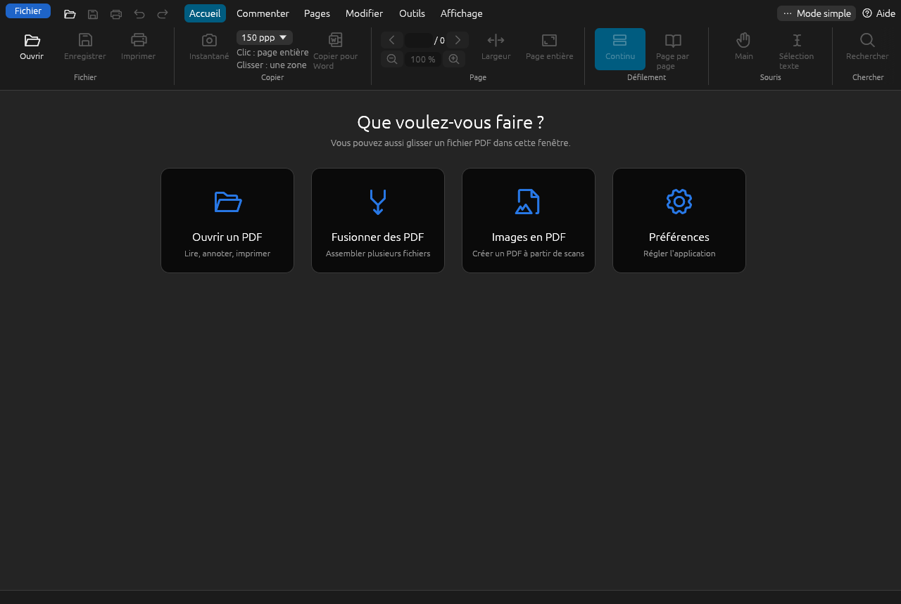
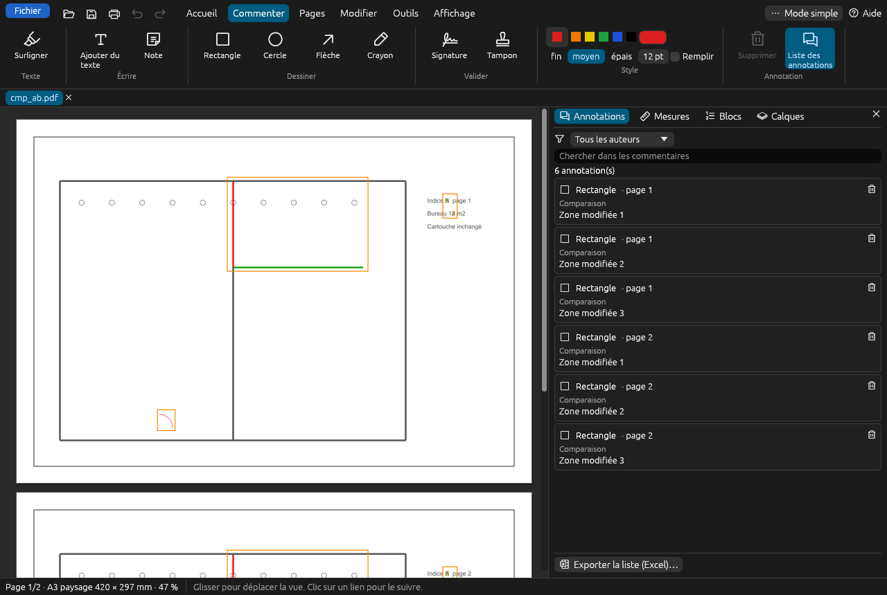
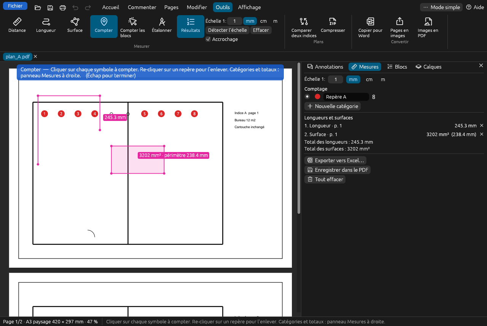

  

<h1 align="center">PDF</h1>

  <b>Le lecteur PDF pensé pour les bureaux d'études.</b> 
  Plans AutoCAD, traceur, métrés, comptage de blocs, comparaison d'indices… dans un seul petit logiciel, 
  sans installation et sans droits administrateur.

  <a href="https://github.com/sephix-hub/pdf-releases/raw/main/v0.6.1/PDF-v0.6.1-win64.zip"><b>⬇ Télécharger PDF v0.6.1 pour Windows</b></a>
  &nbsp;·&nbsp; Windows 10 / 11 (64 bits) &nbsp;·&nbsp; 11 Mo

---

## Pourquoi PDF ?

Au quotidien, un bureau d'études passe son temps sur des PDF : plans d'architecte, plans d'exécution,
indices successifs, notices, DOE… Les lecteurs PDF classiques sont faits pour lire des documents texte,
pas des plans de 1,80 m. **PDF** a été écrit par un projeteur, pour les projeteurs :

- **Rapide sur les gros plans** : même un plan de 1800 × 900 mm s'ouvre, se zoome et s'imprime sans ramer.
- **Portable** : deux fichiers dans un dossier, aucun installeur, aucun droit administrateur. Il marche sur un PC verrouillé.
- **Simple** : un ruban comme Word, de grosses icônes avec leur nom, une bulle d'aide sur chaque bouton,
  un bandeau qui dit quoi faire quand un outil est actif. Le *mode simple* n'affiche que l'essentiel.
- **Fait pour le métier** : comptage des blocs AutoCAD, calques, comparaison d'indices, mesures à l'échelle,
  impression traceur… des fonctions qu'on ne trouve d'habitude que dans des logiciels chers.

---

## Ce que PDF sait faire

### 📐 Comparer deux indices d'un plan
Choisis l'ancien et le nouvel indice : PDF les superpose et montre tout de suite ce qui a changé.

- **Rouge** = supprimé, **vert** = ajouté, **gris** = inchangé.
- Chaque zone modifiée est **encadrée en orange** et listée : un clic pour y aller.
- Si le nouvel indice est **décalé**, PDF le **recale automatiquement** avant de comparer.

### 🔢 Compter les blocs AutoCAD
Prises, RJ45, luminaires, attentes… PDF lit les **calques** du plan exporté d'AutoCAD et compte les blocs tout seul.

- Coche un calque, ou clique sur un symbole du plan : chaque bloc est **encadré et compté**,
  rangé par type (prise simple, double, triple…) avec une **vignette**.
- La **légende et le cartouche** ne sont pas comptés. Tu peux **limiter le comptage à une zone** (une pièce, un niveau).
- Un bloc compté par erreur ? Un clic pour le retirer.
- **Export Excel** de tous les plans ouverts : plan, calque, type, quantité.

### 📏 Mesurer et métrer
- **Distance**, **longueur** d'un tracé (gaine, réseau, cloison), **surface** et périmètre.
- **Accrochage** aux extrémités, milieux et croisements des traits : des mesures justes sans zoomer à fond.
- **Échelle** : saisie à la main, **étalonnage** sur une cote connue, ou bouton **« Détecter l'échelle »**
  qui lit « Échelle 1/50 » dans le cartouche.
- **Compter** des symboles à la main, par catégories de couleur.
- Totaux en direct, **export Excel**, et **« Enregistrer dans le PDF »** pour dessiner les cotes dans le plan.

### 🗂 Calques
Affiche ou masque les calques du plan (fond d'architecte, CFO, CFA, cotes, mobilier…), avec une recherche par nom.
L'impression, les instantanés et les exports suivent ce que tu vois. Le fichier, lui, n'est jamais modifié.

### 🖨 Impression bureau d'études
- **Format automatique par page** : un dossier qui mélange A4 et A3 sort correctement.
- **Traceur** au format exact du plan (900 × 3000 mm, etc.).
- Couleur ou **noir pur**, **recto verso**, et des **profils** enregistrés (« A3 couleur RV », « Traceur 1/50 »…).

### 📸 Instantanés et Word
- **Instantané** haute qualité (150 ppp par défaut) : un clic = la page entière, un glisser = une zone,
  directement dans le presse-papier.
- **Copier pour Word** : tout un PDF de 20 pages dans Word en un clic, une image par page, en image légère ou en **bitmap qualité maximale**.

### ✏️ Annoter et modifier
- Surligner, texte, notes, rectangles, cercles, flèches, crayon. Déplacer, redimensionner, changer de couleur.
- **Tampons** (BON POUR EXÉCUTION, VALIDÉ, VU, REFUSÉ…) avec date et nom, **signature** mémorisée.
- **Corriger le texte** d'une ligne, **masquer une zone** (caviardage réel), **recadrer**, **filigrane**,
  **numéros de page**, en-têtes et pieds de page.
- **Liste des annotations** : toutes les remarques du document, filtre par auteur, export Excel.

### 📄 Pages et fichiers
- **Organiser les pages** par glisser-déposer, faire pivoter, supprimer, insérer.
- **Fusionner**, **découper**, **pages en images**, **images en PDF**.
- **Compresser** un PDF trop lourd pour un mail (seules les photos sont allégées, les traits restent nets).

### 🪟 Confort
- **Onglets**, et un onglet glissé hors de la fenêtre s'ouvre dans une **nouvelle fenêtre** (pratique sur deux écrans).
- Défilement continu ou **page par page**, zoom jusqu'à 6400 %, recherche, signets, miniatures.
- **Mises à jour** proposées dans le logiciel : un bandeau, un clic, c'est fait.

---

## Installer

1. Télécharge **[PDF-v0.6.1-win64.zip](https://github.com/sephix-hub/pdf-releases/raw/main/v0.6.1/PDF-v0.6.1-win64.zip)**.
2. Clic droit sur le zip → *Propriétés* → coche **Débloquer** → *OK*, puis extrais-le.
3. Range `PDF.exe` et `pdfium.dll` **dans le même dossier** (par exemple `Documents\Outils\PDF`) et lance `PDF.exe`.
4. Pour ouvrir tous tes PDF avec : menu **Fichier → Ouvrir mes PDF avec ce logiciel**, puis choisis « PDF » dans la fenêtre de Windows.

Aucun droit administrateur n'est nécessaire. Les versions suivantes sont proposées directement dans le logiciel.

**Service informatique** : le fichier `LISEZMOI-INFORMATIQUE.md` du zip décrit précisément ce que fait le programme
(fichiers écrits, réseau, registre) pour faciliter son autorisation.

---

## Historique

| Version | Principales nouveautés |
|---|---|
| **0.6.1** | Retour du réglage « Ouvrir mes PDF avec ce logiciel » |
| 0.6 | Comptage des blocs AutoCAD, calques, accrochage des mesures, détection de l'échelle, comparaison recalée, mises à jour intégrées |
| 0.5 | Comparaison d'indices, mesures avancées et export Excel, compression, liste des annotations |
| 0.4 | Interface en ruban, signature, tampons, correction de texte, caviardage, organisation des pages, copie vers Word, instantanés plus rapides |
| 0.3 | Onglets et fenêtres détachables, défilement page par page, icônes avec bulles d'aide |

---

  © 2026 Noé SUIVENG — Tous droits réservés. 
  Logiciel propriétaire, gratuit pour un usage autorisé par l'auteur. Code source non public. 
  Rendu PDF par PDFium (Google, licence BSD). Licences des composants tiers : menu <i>Aide → À propos</i>.

