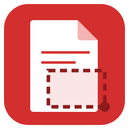

  

<h1 align="center">PDF</h1>

  <b>Un lecteur et éditeur PDF simple, rapide et complet, pour tout le monde.</b> 
  Lire, annoter, signer, modifier, organiser, imprimer… et des outils avancés pour ceux qui en ont besoin.

  <a href="https://github.com/sephix-hub/pdf-releases/raw/main/v0.8.0/PDF-v0.8.0-installation.exe"><b>⬇ Installer PDF — PC perso</b></a> (version 0.8.0)
  &nbsp;·&nbsp;
  <a href="https://github.com/sephix-hub/pdf-releases/raw/main/v0.6.3/PDF-v0.6.3-portable.zip"><b>⬇ Version entreprise — portable</b></a> (version 0.6.3)
   Windows 10 / 11 (64 bits) &nbsp;·&nbsp; sans droits administrateur

---

## Fonctionnalités

### 📖 Lire
- Ouverture rapide, même des très gros fichiers.
- **Onglets** ; un onglet glissé hors de la fenêtre s'ouvre dans une **nouvelle fenêtre** (pratique sur deux écrans).
- Défilement continu ou **page par page**, une ou deux pages, zoom jusqu'à 6400 %.
- **Recherche** dans le texte, signets, miniatures, liens cliquables, plein écran, thème clair ou sombre.
- **Mode simple** (l'essentiel) ou **mode complet** (tous les outils), au choix.

### ✏️ Annoter
- Surligner, souligner, barrer, ajouter du texte, des notes, des rectangles, cercles, flèches, dessin à main levée.
- Déplacer, redimensionner, changer la couleur ou l'épaisseur d'une annotation.
- **Liste des annotations** : toutes les remarques du document, filtre par auteur, recherche, export Excel.

### ✍️ Signer et valider
- **Signature** dessinée une fois à la souris (ou image scannée), mémorisée et posée en un clic.
- **Tampons** prêts à l'emploi (VALIDÉ, VU, REFUSÉ, POUR INFORMATION…) ou personnalisés, avec date et nom.

### 🛠 Modifier
- **Corriger une ligne de texte**, ajouter une **image** ou un logo.
- **Masquer une zone** : le contenu est réellement supprimé, pas seulement recouvert.
- **Filigrane**, **numéros de page**, en-têtes et pieds de page.
- **Recadrer** les pages, **figer** les annotations.

### 📄 Pages et fichiers
- **Organiser les pages** par glisser-déposer, faire pivoter, insérer, extraire, supprimer.
- **Fusionner** plusieurs PDF, **découper** un PDF, **pages en images**, **images en PDF**.
- **Compresser** un PDF trop lourd pour un mail : seules les photos sont allégées, le texte reste net.

### 📸 Copier et exporter
- **Instantané** haute qualité : un clic = la page entière, un glisser = une zone, directement dans le presse-papier.
- **Copier pour Word** : tout un document dans Word en un clic, une image par page (légère ou qualité maximale).
- Copie du texte sélectionné.

### 🖨 Imprimer
- Format choisi automatiquement pour chaque page (un document qui mélange A4 et A3 sort correctement).
- Couleur ou noir pur, recto verso, très grands formats, **profils** d'impression enregistrés.

---

## Fonctions avancées

Des outils en plus pour ceux qui travaillent sur des plans et des documents techniques.
Ils restent discrets tant qu'on ne s'en sert pas.

### 📐 Comparer deux versions d'un document
PDF superpose l'ancienne et la nouvelle version et montre tout de suite ce qui a changé :
**rouge** = supprimé, **vert** = ajouté, **gris** = inchangé. Chaque modification est encadrée et listée.
Si la nouvelle version est décalée, elle est **recalée automatiquement**.

### 📏 Mesurer
- **Distance**, **longueur** d'un tracé, **surface** et périmètre, à l'échelle du document.
- **Accrochage** aux extrémités, milieux et croisements des traits.
- Échelle saisie, **étalonnée** sur une cote connue, ou **détectée** dans le texte (« Échelle 1/50 »).
- **Compter** des symboles à la main, totaux en direct, **export Excel**, mesures enregistrables dans le PDF.

### 🔢 Compter les blocs d'un plan AutoCAD
Sur un plan exporté d'AutoCAD, PDF compte automatiquement les symboles (prises, luminaires…) par calque et par type,
avec vignettes, exclusion de la légende, comptage limité à une zone et export Excel.

### 🗂 Calques
Afficher ou masquer les calques d'un PDF, avec recherche par nom. L'impression et les exports suivent ce qui est affiché ;
le fichier n'est pas modifié.

---

## Points forts

- **Portable ou installé**, au choix, **sans droit administrateur**.
- **Léger et rapide**, même sur de très gros documents.
- **Simple** : un ruban comme Word, de grosses icônes avec leur nom, une bulle d'aide sur chaque bouton.
- **Deux versions** : installée et à jour pour le PC perso, portable et éprouvée (0.6.3) pour l'entreprise.

---

## Installer

Deux versions selon le poste.

### PC personnel — installation (dernière version 0.8.0)

C'est la version à jour, avec les dernières améliorations.

1. Télécharge **[PDF-v0.8.0-installation.exe](https://github.com/sephix-hub/pdf-releases/raw/main/v0.8.0/PDF-v0.8.0-installation.exe)** et lance-le.
2. Si Windows affiche « Windows a protégé votre ordinateur » : *Informations complémentaires* → *Exécuter quand même*.
3. Suivant, Suivant… : PDF s'installe dans ton compte Windows, avec un raccourci dans le menu Démarrer.

PDF apparaît dans **Paramètres → Applications installées**. Pour une version plus récente plus tard,
reviens sur cette page et télécharge le nouvel installateur.

### PC d'entreprise — portable (version 0.6.3, éprouvée)

Sur un poste d'entreprise, l'antivirus est beaucoup plus strict. On garde donc la **version 0.6.3**,
stable et éprouvée, en **portable** (les versions plus récentes y déclenchaient des alertes).

1. Télécharge **[PDF-v0.6.3-portable.zip](https://github.com/sephix-hub/pdf-releases/raw/main/v0.6.3/PDF-v0.6.3-portable.zip)**.
2. Clic droit sur le zip → *Propriétés* → coche **Débloquer** → *OK*, puis extrais-le.
3. Range `PDF.exe` et `pdfium.dll` **dans le même dossier** et lance `PDF.exe`.

Cette version **ne se met pas à jour toute seule**, volontairement : aucun changement de fichier qui
réveillerait l'antivirus. Pour la faire autoriser durablement sur le parc, le fichier
`LISEZMOI-INFORMATIQUE.md` du zip décrit ce que fait le programme (fichiers écrits, réseau, registre)
pour le service informatique.

Aucune des deux versions ne demande de droits administrateur.

---

## Historique

| Version | Principales nouveautés |
|---|---|
| **0.8** · PC perso | Un seul fichier, démarrage plus rapide, mise à jour par réinstallation |
| **0.6.3** · entreprise | Version éprouvée, conservée pour les postes d'entreprise |
| 0.6.2 | Ouverture des PDF depuis un NAS / dossier réseau corrigée |
| 0.6.1 | Retour du réglage « Ouvrir mes PDF avec ce logiciel » |
| 0.6 | Comptage des blocs AutoCAD, calques, accrochage des mesures, détection de l'échelle, comparaison recalée, mises à jour intégrées |
| 0.5 | Comparaison de versions, mesures avancées et export Excel, compression, liste des annotations |
| 0.4 | Interface en ruban, signature, tampons, correction de texte, caviardage, organisation des pages, copie vers Word, instantanés plus rapides |
| 0.3 | Onglets et fenêtres détachables, défilement page par page, icônes avec bulles d'aide |

---

  © 2026 SEPHIX — Tous droits réservés. 
  Logiciel propriétaire, gratuit pour un usage autorisé par l'auteur. Code source non public. 
  Rendu PDF par PDFium (Google, licence BSD). Licences des composants tiers : menu <i>Aide → À propos</i>.

